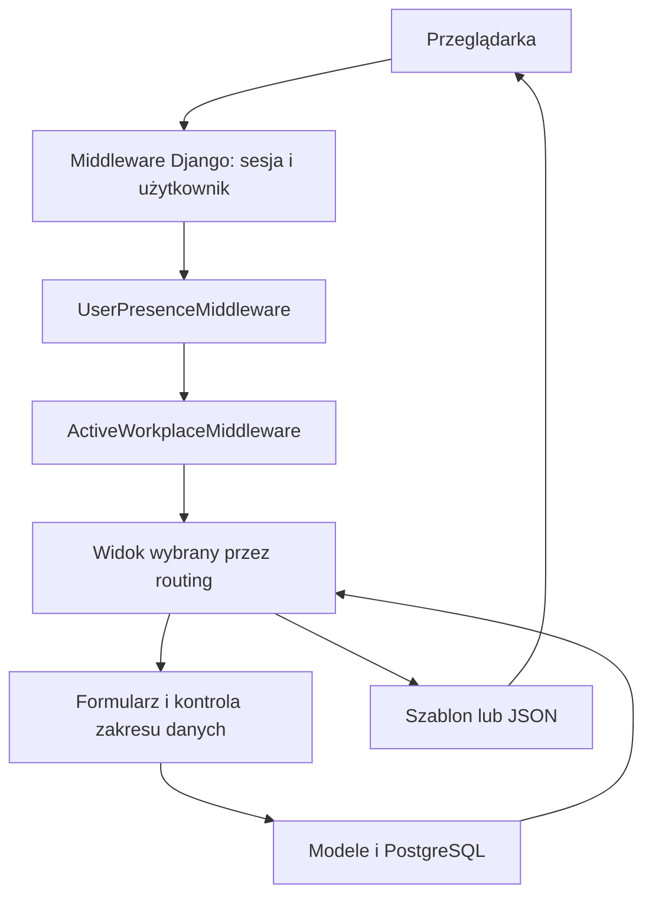

# Architektura Ancore

## 1. Kształt aplikacji

Moduł [Filtry](FILTERS.md) należy do dashboard: model zapisanej definicji,
osobny routing pod /filters/ i /workplaces/<slug>/filters/, formularze
oraz kompilator warunków do ORM. Wyniki odczytują wyłącznie bieżące zadania
przez istniejący zakres widoczności Przestrzeni.

Ancore jest aplikacją Django podzieloną na moduły domenowe we wspólnym procesie.
Serwer pobiera dane przez ORM i waliduje je formularzami. Frontend aktywnej aplikacji korzysta
z Reacta i TypeScriptu. Zasoby, Kalendarz, Dla ciebie,
centrum Ustawień, Przestrzenie z Tagami,
zadania Przestrzeni, Zespoły, Filtry, Pulpity, Dysk, Dokumenty, zarządzanie Workspace
oraz konta i profil korzystają z `frontend/app` i JSON API v1.
Menu, nagłówek, Favorites, pickery, wyszukiwanie, centrum powiadomień, Sticker
i komunikaty mają trwały korzeń Reacta. Nawigacja pobiera dane JSON i montuje
kolejny ekran React bez pobierania HTML. Szablony zachowują pierwszy render
i zgodność, a wspólne helpery pozostają adapterami komponentów. Sesja, CSRF, Workspace
i uprawnienia pozostają po stronie Django. Budowanie, kontrakt API i granice
migracji opisuje [Frontend React](FRONTEND.md).

Osobny pakiet `frontend/board` buduje odizolowany edytor Excalidraw/React do iframe.
Pełne edytory biurowe
uruchamia osobny serwer ONLYOFFICE. Python używa Django, `psycopg2-binary`,
`python-dotenv` i PyJWT. Szczegóły: [Dokumenty](OFFICE.md).
Kod używa mechanizmów PostgreSQL, w tym indeksów GIN i rozszerzenia `pg_trgm`.

Źródła: [settings.py](../backend/ancore/settings.py), [requirements.txt](../requirements.txt),
[główny routing](../backend/ancore/urls.py).

## 2. Struktura katalogów

```text
backend/                katalog źródeł Pythona, dodawany do ścieżki importów
  ancore/               konfiguracja, główny routing, WSGI/ASGI i test runner
  accounts/             użytkownik, logowanie, profil, wiele kont, obecność
  workplaces/           Workspace, aktywny kontekst, nawigacja, ulubione
  spaces/               przestrzenie, zadania, historia, pliki, planowanie i zespoły
  tasks/                słownik tagów Przestrzeni i wspólne komponenty
  planner/              wydarzenia i kalendarz
  resources/            ewidencja sprzętu, licencji i narzędzi Workspace
  documents/            Dysk, Dokumenty i bezpieczna integracja edytorów
  dashboard/            pulpity, ustawienia, wyszukiwanie i powiadomienia
  core/                 wspólna powłoka aplikacji, JSON API i walidacja uploadu
frontend/board/         izolowany bundle Excalidraw/React i lockfile
frontend/app/           frontend React/TypeScript aktywnych modułów
deploy/                 produkcyjny Compose, obrazy, proxy, backup i ONLYOFFICE
  cli/                  wspólne operacje instalacji i konfigurator
  backend/              entrypoint Django, Gunicorn i zależności produkcji
  web/                  entrypoint Nginx i szablon konfiguracji
  postgres/             inicjalizacja roli aplikacji
  backup/               archiwizacja, harmonogram i odtwarzanie
static/css/             tokeny, reset, układ, komponenty, theme, reguły globalne
static/js/              wspólne i modułowe skrypty przeglądarki
static/frontend/        generowany bundle React z manifestem, poza Git
static/img/             logo, ilustracje i favicon
static/vendor/          lokalne biblioteki, ikony i generowany bundle tablicy
media/                  pliki obsługiwane przez standardowy MEDIA_ROOT
private_documents/      prywatne pliki Dysku, Dokumentów i komentarzy
docs/                   opisy projektu i generowany indeks kodu
scripts/                narzędzia dokumentacji, utrzymania i lokalnego ONLYOFFICE
  assets/               generator ikon i jego mapowanie
  office/               konfiguracja i start lokalnego ONLYOFFICE
.local/                 opcjonalne pliki lokalne, poza Git i buildem
.cache/                 odtwarzalny cache narzędzi, poza Git i buildem
ancore.sh               wspólne polecenia instalacji i utrzymania produkcji
restore.sh              samodzielny wybór kopii i pełne odzyskiwanie aplikacji
manage.py               wejście do poleceń Django
requirements.txt        zależności Pythona
AGENTS.md               instrukcje pracy agenta
.env.example            przykład lokalnej konfiguracji bez sekretów
.editorconfig           wspólne reguły zapisu i wcięć plików
.vscode/settings.json   importy Pythona i widoczność plików technicznych
```

`.env` zawiera lokalną konfigurację; `.venv` lokalne środowisko Python.
Osobny `deploy/.env` generuje instalator produkcji, z losowymi sekretami.
Treść uploadów i sekrety nie należą do dokumentacji.
Pełny indeks źródeł znajduje się w [CODE_INDEX.md](CODE_INDEX.md), a zasady
dodawania plików w [Organizacji repozytorium](REPOSITORY.md).

`backend/` jest katalogiem źródeł, nie nową przestrzenią nazw Pythona.
Importy nadal używają `spaces`, `accounts`, `ancore.settings` itd.
Nowe migracje początkowe tworzą aktualny schemat na pustej bazie.
Historyczne modele pracy oraz pakiety `legacy` i `kanban` usunięto.
[Zasady uruchomienia](DATABASE.md).

Główny `manage.py` ustawia ścieżkę importów niezależnie od katalogu roboczego.
`BackendDiscoverRunner` zachowuje pełne wykrywanie testów bez podawania etykiet.
WSGI/ASGI i inne bezpośrednie procesy wymagają dodania `backend/` do `PYTHONPATH`;
szczegóły są w [instrukcji developerskiej](DEVELOPMENT.md#8-wdrożenie).
`BASE_DIR` nadal oznacza katalog główny repozytorium, a `BACKEND_DIR` katalog
źródeł Django. Domyślne lokalizacje `.env`, uploadów i zasobów pozostają takie same.
Produkcja może wskazać `MEDIA_ROOT`, `PRIVATE_DOCUMENT_ROOT`, `STATIC_ROOT`
i katalog uploadów tymczasowych przez środowisko. [Instalacja pięciu usług](PRODUCTION.md)
rozdziela WWW, backend, PostgreSQL, backup i ONLYOFFICE; pliki mają trwałe lokalne
wolumeny bez szyfrowania. Middleware `core.maintenance` synchronizuje żądania
z backupem bazy i plików. `/health/ready/` sprawdza gotowość bazy bez ujawniania
danych użytkowników. Healthchecki usług nie zastępują zewnętrznego monitoringu.
`ancore.sh` jest wspólnym wejściem instalacji, konfiguracji i utrzymania.
Budowanie obrazów i obu frontendów odbywa się na tym samym serwerze;
obrazy bazowe i zależności są pobierane z internetu przy instalacji.
`deploy/cli/runtime.sh` zawiera implementację operacji Compose i starszego odtwarzania danych,
`deploy/cli/setup.sh` konfigurator terminalowy, a `deploy/cli/configure.py` walidację
i zapis ustawień w kontenerze Pythona. `scripts/production.py` przekazuje starsze
polecenia do tych samych implementacji. Domyślna instalacja używa HTTP na
`0.0.0.0:8080`, bez stałej domeny. `core.hosts.ServerAddressMiddleware`
przy `ALLOW_IP_HOSTS=true` ogranicza hosty do IP i localhost. Opcjonalne HTTPS
z certyfikatem Nginx albo zewnętrznym proxy zachowuje sekrety i wolumeny przy
`--reconfigure`. Publiczny prefiks ONLYOFFICE jest względny (`/onlyoffice`),
więc edytor używa adresu wybranego przez przeglądarkę. Wyniki callbacków są
pobierane ze stałego wewnętrznego serwera po walidacji ścieżki cache.

Backup domyślnie powstaje co 24 godziny z retencją 10 kopii. Format 2 dodaje
do bazy i zapisanych plików snapshot źródeł z obrazu backupu, konfigurację
produkcji i certyfikaty HTTPS Nginx Ancore. `restore.sh` jest niezależnym,
samodzielnym skryptem: wyświetla 10 kopii, sprawdza wybraną, odbudowuje jej
kod, odtwarza dane na nowych wolumenach i czeka na gotowość aplikacji.
Nie uruchamia instalatora. Odtworzona instalacja działa z osobnego katalogu;
`deploy/compose.recovery.yaml` utrwala nowe nazwy wolumenów także dla poleceń
utrzymania. Stare wolumeny pozostają zachowane. Snapshot nie obejmuje
niezapisanych edycji i cache ONLYOFFICE ani konfiguracji zewnętrznych usług hosta.
Szczegóły i ograniczenia: [Backup i odtwarzanie](PRODUCTION.md#backup-i-odtwarzanie).

## 3. Warstwy i odpowiedzialności

| Warstwa | Odpowiedzialność | Główne źródła |
| --- | --- | --- |
| Routing | Wybór modułu, endpointu i nazwy URL | `backend/ancore/urls.py`, modułowe `urls.py` |
| Middleware | Sesja, uwierzytelnienie, obecność, Workspace, CSRF | `backend/ancore/settings.py`, middleware Accounts/Workplaces |
| Widoki | Zakres dostępu, akcja, wybór formularza, odpowiedź | modułowe `views.py`, `backend/spaces/task_views.py` |
| JSON API | Kontrakt Reacta, sesja, błędy i zakres danych | `backend/core/api.py`, `backend/core/frontend.py`, `backend/core/shell.py`, domenowe `frontend.py`, `backend/resources/api.py` |
| Formularze | Walidacja i wybór dostępnych powiązań | modułowe `forms.py` |
| Modele | Dane, relacje, unikalność, zapis i sygnały | modułowe `models.py`, `migrations/` |
| Szablony | Układ strony, pola, listy i kontrakt `data-*` | modułowe `templates/` |
| CSS | Wygląd i responsywność | `static/css/` |
| JavaScript | Interakcje i komunikacja HTTP | `static/js/` |
| React/TypeScript | Stan i renderowanie przeniesionych modułów | `frontend/app/src/` |

Historyczne widoki, formularze i ekrany Tasks/Kanbana/Kontaktów usunięto.
`tasks.forms` zawiera wyłącznie formularz tagu, a `tasks.tag_directory`
filtrowanie, sortowanie i paginację tagów Przestrzeni. `static/js/tasks.js` nadal obsługuje
wspólne komponenty bieżących modułów. Nie zakładaj istnienia osobnej warstwy usług dla każdej
operacji. Moduł `workplaces.services` jest rzeczywistą wspólną warstwą kontekstu.

## 4. Przepływ żądania



`AuthenticationMiddleware` działa przed middleware obecności i Workspace.
Widok otrzymuje `request.user` oraz `request.workplace`. Context processory
uzupełniają szablony o avatar, listę Workspace, adresy modułów i ulubione.

GET może mieć uboczne efekty techniczne: obecność, sesja aktywnego Workspace,
uzupełnienie starych rekordów bez Workspace oraz inicjalizacja domyślnych
słowników. Nie utożsamiaj samej metody GET z całkowitym brakiem zapisu w tym kodzie.

## 5. Główne zależności

- `accounts.User` jest wspólnym modelem konta, `workplaces.Workplace` granicą danych.
  `User.default_workplace` przechowuje osobisty Workspace otwierany po logowaniu;
  relacja nie nadaje dostępu i jest sprawdzana przez `workplaces.services`.
- `spaces.Space` organizuje `SpaceTask`, planowanie `WorkItem`, sprinty i zespoły.
  Dostęp wyznacza `spaces.access` oraz role przestrzeni i zadań.
- `tasks.TaskTag` i `TaskTagNote` obsługują katalogi tagów Przestrzeni.
- `planner` łączy wydarzenia z terminami bieżących zadań, bez kopiowania rekordów.
- `dashboard` integruje pulpity, filtry, wyszukiwanie, komentarze Przestrzeni,
  osobiste przypomnienia `SpaceTaskReminder`.
  `NotificationState` zapisuje osobisty stan komentarzy i przypomnień.
- `documents` i `resources` zachowują niezależne modele oraz wspólny kontekst Workspace.
- `core` dostarcza powłokę, JSON API, walidację i obsługę plików.

## 6. Hierarchie danych

```text
Użytkownik → Workspace
  ├─ Space → SpaceTask → podzadanie
  │           ├─ WorkItem → planowanie, sprint, zespół, trwały klucz
  │           ├─ SpaceTaskActivity → SpaceTaskFile
  │           ├─ SpaceTaskMembership
  │           ├─ SpaceTaskReminder
  │           └─ SpaceTaskWorkLog
  ├─ Team → TeamMembership
  ├─ CalendarEvent + terminy SpaceTask
  ├─ Resource
  ├─ DocumentLibrary → Folder / Document
  └─ WorkspaceDocument

TaskTag ↔ SpaceTask
```

Schemat Dokumentów zachowuje `WorkspaceDocumentFolder`, dawne powiązania tagów
oraz `DocumentVersion`. Ich ekrany pozostają wyłączone; [opis modułu](MODULES.md).

## 7. Adresy i punkt wejścia

- `/` oraz `/dashboards/default/` (także scoped) pokazują osobisty pulpit
  domyślny aktywnego Workspace przez wspólny przegląd i edytor Pulpitów.
  Pierwsze wejście tworzy `Dashboard.is_default` i jeden gadżet „Postęp pracy”;
  unikalność `(created_by, workplace)` dla domyślnych rekordów chroni inicjalizację.
  Kolejne wejścia zachowują konfigurację, również pusty pulpit.
- `/dashboards/` i `/workplaces/<slug>/dashboards/` udostępniają system
  „Pulpity”. `Dashboard` przechowuje konfigurację i udostępnienie,
  `DashboardGadget` układ oraz filtry; `pulpit_views.py`, `pulpit_forms.py`
  i `pulpits.py` obsługują katalog, zapis i odczyt danych. Właściciel danych
  Workspace (`owner`) jest oddzielony od twórcy (`created_by`).
  `pulpit_navigation.py` buduje menu gwiazdek i ostatnich z aktualnie
  dostępnych pulpitów. „Pulpit domyślny” ma stałą pozycję w menu bez duplikowania
  go w osobistych gwiazdkach i ostatnich. Jest widoczny w katalogu;
  ma te same ustawienia i dostępy, ale nie można usunąć jego rekordu.
  Osobny ekran „Zarządzaj pulpitami” został usunięty. Dawne
  `/dashboards/manage/` i scoped odpowiednik przekierowują do katalogu „Pulpity”,
  zachowując wyszukiwanie, widoczność i numer strony. Menu oraz Ustawienia
  nie pokazują wejścia do dawnego ekranu. Ustawienia i dostępy konkretnego pulpitu
  pozostają w dużym oknie otwieranym z jego menu.
  `Dashboard.slug` jest nazwą w formie URL, przydzielaną w obrębie Workspace
  przy tworzeniu (istniejącym rekordom przez `dashboard.0012_dashboard_slugs`).
  Duplikaty dostają końcówkę `-2`, `-3`; późniejsza zmiana nazwy nie zmienia adresu.
  `/<slug>/access/` zmienia widoczność/osoby, `/<slug>/edit/` nazwę, opis,
  ikonę, zakres danych i interwał odświeżania;
  oba mają warianty `/manage/<slug>/` i scoped. Zapis i anulowanie zachowują
  kontekst wejścia oraz filtry katalogu. Tworzenie pozostaje modalem.
  Mechanizm grup pulpitów jest usunięty; dawne adresy `groups/` i przypisania
  `<pk>/groups/` zwracają 404 w zwykłym i scoped routingu.
  Kopiowanie pulpitów jest usunięte; dawne `<pk>/copy/` i
  `manage/<pk>/copy/` zwracają 404 również w scoped routingu.
  Przegląd `/<slug>/` wyświetla gadżety bez kontrolek ich zmiany, także twórcy.
  Dawne `/<pk>/` przekierowuje po kontroli dostępu, zachowując parametry URL.
  Numeryczne endpointy edycji i POST nadal działają dla zgodności.
  Osobny edytor `/<slug>/gadgets/` i `/manage/<slug>/gadgets/` używa menu wybranego pulpitu;
  właściciel, administrator i członek dodają, konfigurują, usuwają i układają gadżety.
  `DashboardMembership` przechowuje role w dotychczasowej tabeli udostępnień;
  ustawienia i dostępy wymagają właściciela lub administratora, a obserwator ma odczyt. Bezpośrednie formularze
  gadżetów otwierają modal nad edytorem, a zapis wraca do edytora.
  Katalog w modalu dodaje „Postęp pracy” do lokalnego szkicu. Wspólny
  `DashboardCanvas` obsługuje siatkę 12 kolumn jak w Podsumowaniu Przestrzeni.
  `arrange` przyjmuje `{revision, widgets: [{id,x,y,w,h,kind?}]}` i zapisuje
  geometrię, nowe oraz usunięte gadżety w jednej transakcji. `Anuluj` odrzuca
  szkic bez zapisu. Migracja `dashboard.0008_dashboard_gadget_grid` zachowuje
  istniejące gadżety i przenosi ich kolumny na pola `x/y/w/h`.
  Blokada rekordu pulpitu chroni limit i rewizję przed równoczesnymi zmianami.
  Starsze `gadgets/quick-add/` oraz kolumnowy format `arrange` pozostają zgodne;
  warianty zarządzania zachowują filtry, wszystkie adresy mają scoped odpowiedniki.
- `/for-you/` oraz `/workplaces/<slug>/for-you/` pokazują osobisty widok
  „Dla ciebie”, składany przez `backend/dashboard/for_you.py` z dostępnych danych.
  `backend/dashboard/recent.py` zapisuje identyfikatory oglądanych elementów w sesji;
  nie tworzy dodatkowych modeli ani kopii danych biznesowych.
- `/accounts/...` obsługuje konto, w tym `/accounts/register/workspace/` jako
  jawne utworzenie nazwanego Workspace po rejestracji oraz `/accounts/workspaces/`
  jako osobny wybór dostępnego Workspace w powłoce kont; `/workplaces/...` Workspace.
  Katalog `/workplaces/` jest osobną stroną z własnym menu zarządzania Workspace.
  Segment `<slug>` w adresach Workspace ma wartość stałego losowego kodu
  `w_` + 26 małych liter/cyfr, niezależnego od dowolnej, powtarzalnej nazwy.
  Stare segmenty zachowuje `Workplace.legacy_slug`; middleware obsługuje je
  z dotychczasowymi kontrolami członkostwa i kieruje GET/HEAD na aktualny adres.
  Osobne ekrany zarządzania Przestrzeniami, Pulpitami i Filtrami są wycofane.
  Ich dawne adresy prowadzą do zwykłych katalogów. Zarządzanie Workspace
  zachowuje własny ekran i menu; edycja ustawień i zespołu nie zmienia aktywnego Workspace. Utworzenie otwiera nowe „Dla ciebie”.
- Moduły mają adresy bazowe `/calendar/`,
  `/documents/` (Dysk), `/office/` (Dokumenty), `/resources/` (Zasoby) oraz warianty
  `/workplaces/<slug>/<moduł>/...`.
- Kalendarz ma etykietę aplikacji `planner`, lecz segment URL `calendar`.
- `/spaces/` jest katalogiem Przestrzeni. Osobny ekran zarządzania usunięto;
  `/spaces/manage/` i scoped odpowiednik przekierowują do katalogu, zachowując
  wyszukiwanie, rodzaj, zakładkę i numer strony. Stare adresy tworzenia/edycji
  nadal kontrolują uprawnienia i wracają do tego katalogu; [szczegóły](SPACES.md).
  Poszczególne przestrzenie używają `/space/<slug>/` i scoped odpowiednika.
  Segment z nazwy przydzielany jest raz w obrębie Workspace; późniejsza edycja
  nazwy zachowuje adres. Stare `/spaces/<pk>/` przekierowuje po kontroli dostępu.
- System „Wartości pól projektu” jest usunięty. Dawny `/settings/project-fields/`
  zwraca 404; projekty zachowują swoje pola i dotychczasowe wartości.
- `/settings/` jest centrum ustawień konta i Workspace oraz zarządzania sesją.
  Główny pasek boczny pokazuje jego kategorie zamiast menu Workspace,
  także przy częściowej nawigacji; [standard UI](UI.md).
- Dawne `/tasks/`, `/kanban/` i `/contacts/` nie mają routingu, również scoped.
  W `tasks/templates/tasks/includes/` pozostają wspólne komponenty aktywnych modułów.

Przy rozbudowie modułu trzeba uwzględnić także nawigację Workspace,
context processor, wyszukiwarkę i ograniczenia częściowej nawigacji.

Zasoby korzystają z osobnego modelu `resources.Resource` i `backend/resources/urls.py`;
scoped namespace to `workplace_resources`. Współdzielą właściciela i aktywny
Workspace, nawigację, ulubione, globalne wyszukiwanie, filtry i paginację Zadań
oraz powłokę modali. Nie są powiązane z prywatnymi projektami ani plikami Dysku.

`DocumentVersion` zachowuje dawne archiwa powiązane z dokładnie jednym rekordem
Dysku albo Dokumentów. Historia wersji nie ma aktywnych ekranów ani endpointów;
nowe zapisy nie tworzą archiwów. `WorkspaceDocument.is_template` oznacza wzorzec w
katalogu właściciela; kopia nie dziedziczy tego oznaczenia.

Dokumenty mają osobne modele w aplikacji `documents`, widoki w
`backend/documents/editor_views.py` i routing `backend/documents/workspace_urls.py` z przestrzeniami
nazw `office` oraz `workplace_office`. Nie są filtrem Dysku i nie przenoszą
jego dotychczasowych danych. Współdzielą prywatny storage, walidację uploadu,
podglądy i powłokę formularzy/modalów. Dysk i Dokumenty korzystają też ze wspólnych
widoków `suite_views.py`, serwisu ONLYOFFICE i powłoki pełnego edytora dla plików
DOCX/XLSX/PPTX/PDF. Zapis pozostaje w modelu źródłowego modułu; osobne podpisy, URL
serwisowe i potwierdzenia zapisu rozdzielają dostęp do obu katalogów.

Katalogi Kontaktów i Firm oraz ich schemat usunięto całkowicie.
[Baza i nowe migracje](DATABASE.md).

## 8. Granice tego opisu

Obecność `ASGI_APPLICATION`/pliku ASGI nie oznacza działającej komunikacji
WebSocket. W sprawdzonych źródłach nie ma workera do automatyzacji tagów,
wysyłania push/e-mail ani synchronizacji kalendarza z zewnętrznym serwisem.
Przypomnienia Przestrzeni materializuje `backend/dashboard/reminders.py` podczas
odpytywania centrum powiadomień; nie wymagają workera. Aktualne ograniczenia i pozostałości historyczne są zebrane w
[MODULES.md](MODULES.md) i [DEVELOPMENT.md](DEVELOPMENT.md).

## Przestrzenie i zespoły (10.10.2026)

`Space` → `SpaceTask` → podzadanie ma własne członkostwa, historię, pliki
i dziennik pracy. `WorkItem` przechowuje planowanie i trwały klucz, np. `PRO-1`.
Lista, tablica, backlog i szczegóły używają tego samego zadania.
Szczegóły są pod `/space/<slug>/tasks/<klucz>/`, także scoped.
Planowanie korzysta z `backend/spaces/backlog.py`; szczegóły: [Przestrzenie](SPACES.md).

## Wycofanie starszych systemów pracy (10.10.2026)

Po resecie z 18.10.2026 starsze systemy pracy usunięto również ze schematu.
Nie ma modeli ani migracji Tasks/Kanbana/Kontaktów, dawnych tras i mapowań importu.
Pozostał katalog tagów i współdzielone komponenty. [Aktualny schemat](DATABASE.md).
