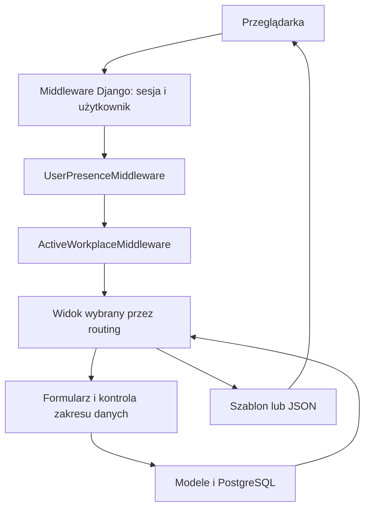
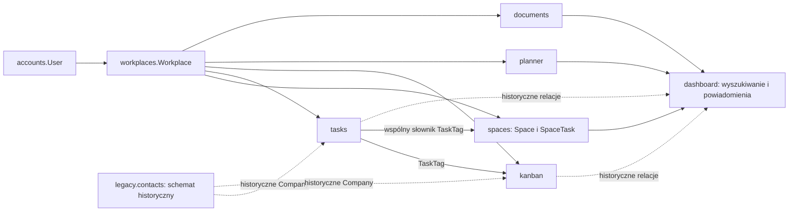

# Architektura Ancore

## 1. Kształt aplikacji

Moduł [Filtry](FILTERS.md) należy do dashboard: model zapisanej definicji,
osobny routing pod /filters/ i /workplaces/<slug>/filters/, formularze
oraz kompilator warunków do ORM. Wyniki odczytują wyłącznie bieżące zadania
przez istniejący zakres widoczności Przestrzeni.

Ancore jest aplikacją Django podzieloną na moduły domenowe we wspólnym procesie.
Serwer pobiera dane przez ORM i waliduje je formularzami. Frontend aktywnej aplikacji korzysta
z Reacta i TypeScriptu. Zasoby, Kalendarz, Dla ciebie,
centrum Ustawień, Przestrzenie z Tagami,
zadania Przestrzeni, Zespoły, Filtry, Pulpity, Dysk, Dokumenty, zarządzanie Workspace
oraz konta i profil korzystają z `frontend/app` i JSON API v1.
Menu, nagłówek, Favorites, pickery, wyszukiwanie, centrum powiadomień, Sticker
i komunikaty mają trwały korzeń Reacta. Nawigacja pobiera dane JSON i montuje
kolejny ekran React bez pobierania HTML. Szablony zachowują pierwszy render
i zgodność, a wspólne helpery pozostają adapterami komponentów. Sesja, CSRF, Workspace
i uprawnienia pozostają po stronie Django. Budowanie, kontrakt API i granice
migracji opisuje [Frontend React](FRONTEND.md).

Osobny pakiet `frontend/board` buduje odizolowany edytor Excalidraw/React do iframe.
Pełne edytory biurowe
uruchamia osobny serwer ONLYOFFICE. Python używa Django, `psycopg2-binary`,
`python-dotenv` i PyJWT. Szczegóły: [Dokumenty](OFFICE.md).
Kod używa mechanizmów PostgreSQL, w tym indeksów GIN i rozszerzenia `pg_trgm`.

Źródła: [settings.py](../backend/ancore/settings.py), [requirements.txt](../requirements.txt),
[główny routing](../backend/ancore/urls.py).

## 2. Struktura katalogów

```text
backend/                katalog źródeł Pythona, dodawany do ścieżki importów
  ancore/               konfiguracja, główny routing, WSGI/ASGI i test runner
  accounts/             użytkownik, logowanie, profil, wiele kont, obecność
  workplaces/           Workspace, aktywny kontekst, nawigacja, ulubione
  spaces/               przestrzenie, zadania, historia, pliki, planowanie i zespoły
  tasks/                historyczne dane pracy, stare linki i wspólny słownik tagów
  kanban/               historyczne źródła kart i zgodność starych adresów
  legacy/contacts/      wyłącznie zgodność historycznego schematu i migracji
  planner/              wydarzenia i kalendarz
  resources/            ewidencja sprzętu, licencji i narzędzi Workspace
  documents/            Dysk, Dokumenty i bezpieczna integracja edytorów
  dashboard/            pulpity, ustawienia, wyszukiwanie i powiadomienia
  core/                 wspólna powłoka aplikacji, JSON API i walidacja uploadu
frontend/board/         izolowany bundle Excalidraw/React i lockfile
frontend/app/           frontend React/TypeScript aktywnych modułów
deploy/                 lokalny serwer ONLYOFFICE (Compose)
static/css/             tokeny, reset, układ, komponenty, theme, reguły globalne
static/js/              wspólne i modułowe skrypty przeglądarki
static/frontend/        generowany bundle React z manifestem, poza Git
static/img/             logo, ilustracje i favicon
static/vendor/          lokalne biblioteki, ikony i generowany bundle tablicy
media/                  pliki obsługiwane przez standardowy MEDIA_ROOT
private_documents/      prywatne pliki Dysku, Dokumentów i komentarzy
docs/                   opisy projektu i generowany indeks kodu
scripts/                narzędzia dokumentacji, ikon i lokalnego ONLYOFFICE
manage.py               wejście do poleceń Django
requirements.txt        zależności Pythona
AGENTS.md               instrukcje pracy agenta
.env.example            przykład lokalnej konfiguracji bez sekretów
.editorconfig           wspólne reguły zapisu i wcięć plików
.vscode/settings.json   importy Pythona i widoczność plików technicznych
```

`.env` zawiera lokalną konfigurację; `.venv` lokalne środowisko Python.
Treść uploadów i sekrety nie należą do dokumentacji.
Pełny indeks źródeł znajduje się w [CODE_INDEX.md](CODE_INDEX.md).

`backend/` jest katalogiem źródeł, nie nową przestrzenią nazw Pythona.
Importy nadal używają `spaces`, `accounts`, `ancore.settings` itd.; etykiety
aplikacji, nazwy tabel i zależności migracji są zachowane. Szablony i testy
pozostają przy swoich aplikacjach. Historyczne modele pozostają w tych samych
aplikacjach lub wydzielonym pakiecie `legacy`, ponieważ uczestniczą w migracjach
i zapisanych relacjach. Zmiana pakietu archiwum nie zmienia etykiet ani nazw tabel.

Główny `manage.py` ustawia ścieżkę importów niezależnie od katalogu roboczego.
`BackendDiscoverRunner` zachowuje pełne wykrywanie testów bez podawania etykiet.
WSGI/ASGI i inne bezpośrednie procesy wymagają dodania `backend/` do `PYTHONPATH`;
szczegóły są w [instrukcji developerskiej](DEVELOPMENT.md#8-wdrożenie).
`BASE_DIR` nadal oznacza katalog główny repozytorium, a `BACKEND_DIR` katalog
źródeł Django. Lokalizacje `.env`, uploadów i zasobów pozostają takie same.

## 3. Warstwy i odpowiedzialności

| Warstwa | Odpowiedzialność | Główne źródła |
| --- | --- | --- |
| Routing | Wybór modułu, endpointu i nazwy URL | `backend/ancore/urls.py`, modułowe `urls.py` |
| Middleware | Sesja, uwierzytelnienie, obecność, Workspace, CSRF | `backend/ancore/settings.py`, middleware Accounts/Workplaces |
| Widoki | Zakres dostępu, akcja, wybór formularza, odpowiedź | modułowe `views.py`, `backend/spaces/task_views.py`; zgodność Tasks/Kanbana w `urls.py` i middleware Przestrzeni |
| JSON API | Kontrakt Reacta, sesja, błędy i zakres danych | `backend/core/api.py`, `backend/core/frontend.py`, `backend/core/shell.py`, domenowe `frontend.py`, `backend/resources/api.py` |
| Formularze | Walidacja i wybór dostępnych powiązań | modułowe `forms.py` |
| Modele | Dane, relacje, unikalność, zapis i sygnały | modułowe `models.py`, `migrations/` |
| Szablony | Układ strony, pola, listy i kontrakt `data-*` | modułowe `templates/` |
| CSS | Wygląd i responsywność | `static/css/` |
| JavaScript | Interakcje i komunikacja HTTP | `static/js/` |
| React/TypeScript | Stan i renderowanie przeniesionych modułów | `frontend/app/src/` |

Historyczne widoki, formularze i ekrany Tasks/Kanbana/Kontaktów usunięto.
`tasks.forms` zawiera wyłącznie formularz tagu, a `tasks.tag_directory`
filtrowanie, sortowanie i paginację tagów Przestrzeni. `static/js/tasks.js` nadal obsługuje
wspólne komponenty bieżących modułów. Nie zakładaj istnienia osobnej warstwy usług dla każdej
operacji. Moduł `workplaces.services` jest rzeczywistą wspólną warstwą kontekstu.

## 4. Przepływ żądania



`AuthenticationMiddleware` działa przed middleware obecności i Workspace.
Widok otrzymuje `request.user` oraz `request.workplace`. Context processory
uzupełniają szablony o avatar, listę Workspace, adresy modułów i ulubione.

GET może mieć uboczne efekty techniczne: obecność, sesja aktywnego Workspace,
uzupełnienie starych rekordów bez Workspace oraz inicjalizacja domyślnych
słowników. Nie utożsamiaj samej metody GET z całkowitym brakiem zapisu w tym kodzie.

## 5. Główne zależności



- `User` jest wspólnym modelem konta. Pola `user`/`owner` w domenach oznaczają
  właściciela rekordu; pola wykonawcy/osoby odpowiedzialnej to osobne relacje.
- `Workplace` jest kontekstem danych zespołu. Właściciel i członkowie mają wspólny
  dostęp; role i zakres pierwszej wersji opisuje [Praca zespołowa](TEAMWORK.md).
  Dane zachowują właściciela Workspace, a autor operacji to `request.user`.
  Bieżąca prywatność i członkostwa należą do `spaces.access`, `SpaceMembership`
  i `SpaceTaskMembership`. Przestrzenie oraz Workspace współdzielą komponenty
  tabel zespołu i picker osoby. Historyczne projekty/grupy/zadania przechowują
  dawne prywatne właścicielstwo i członkostwa, lecz `tasks.access.visible_to`
  wyklucza te modele z aktywnego odczytu. Ich dawne widoki zespołów nie mają tras.
- Zadania i Kanban mają różne hierarchie i osobne tabele. Kanban nie jest
  jedynie innym sposobem wyświetlenia `Task`. `kanban.access` ogranicza przestrzenie,
  tablice i dziedziczoną zawartość historyczną, obecnie zawsze zwracając pusty
  wynik; wspólne `tasks.access` deleguje do niego modele Kanbana.
  Członkostwa przestrzeni/tablic mają własne tabele i wspólne komponenty UI zespołu.
- Tagi pochodzą z `tasks.TaskTag`. Relacja `space` wyznacza niezależny katalog
  każdej przestrzeni; rekordy bez przestrzeni pozostają wyłącznie historyczne.
  Globalny katalog i jego akcje są wycofane, bez menu, Favorites i wyszukiwania.
  Kanban oraz Dokumenty zachowują historyczne powiązania.
- `dashboard` integruje moduły w wyszukiwaniu; powiadomienia buduje z aktywności
  typu komentarz z Przestrzeni, zaproszeń Workspace oraz osobistych przypomnień
  `spaces.SpaceTaskReminder`. Historyczne `TaskReminder` nie są dostarczane.
  Wycofany Kanban pozostaje tylko źródłem danych historycznych i mapowań importu.
  Wpisy historii zmian pozostają wyłącznie w historii obiektów.
- `core` dostarcza powłokę interfejsu i upload; `core` nie ma własnych modeli domenowych. `dashboard.NotificationState`
  zapisuje osobisty odczyt, archiwum i usunięcie powiadomień, odwołując się do istniejących
  aktywności, zaproszeń i dostarczonych przypomnień. `ObjectFollow` i
  `ActivityInterest` zachowują historyczne subskrypcje i odbiorców aktywności
  Tasks/Kanbana, bez nowych dostarczeń. Wzmianki Przestrzeni są zapisane
  w metadanych `SpaceTaskActivity`.

## 6. Hierarchie danych

```text
Użytkownik → Workspace
  ├─ Historyczne Zadania: TaskProject → TaskSection → Task → podzadanie
  │                                      ├─ TaskActivity → TaskCommentImage
  │                                      ├─ TaskAttachment
  │                                      └─ TaskWorkLog
  ├─ Kanban: KanbanProject → KanbanSection → KanbanBoardColumn
  │                                         └─ Kanban → podkarta
  │                                              ├─ KanbanActivity → KanbanCommentImage
  │                                              └─ KanbanAttachment
  ├─ Historyczne dane Kontaktów: Company ← Contact ← UserContact → konto Ancore
  ├─ Kalendarz: CalendarEvent + terminy SpaceTask (bez kopiowania rekordów)
  ├─ Zasoby: Resource (typ, status, przypisanie, lokalizacja i daty)
  ├─ Dysk: DocumentLibrary → Folder / Document (foldery mogą być zagnieżdżone)
  └─ Dokumenty: WorkspaceDocument (płaski katalog)

TaskTag ↔ Task / Kanban
```

Model `WorkspaceDocumentFolder` i relacja `WorkspaceDocument.folder` pozostają
wyłącznie dla zgodności ze starymi danymi; Dokumenty nie udostępniają już folderów.
Podobnie relacje `Document.tags` i `WorkspaceDocument.tags` przechowują jedynie
historyczne powiązania. Dysk i Dokumenty nie udostępniają tagów, nie wyszukują
po nich ani nie przypisują ich przy zapisie lub kopiowaniu.

Modele `TaskCommentImage` i `KanbanCommentImage` zachowują historyczne nazwy,
ale przechowują zarówno zdjęcia, jak i pozostałe pliki komentarzy.

Diagram pokazuje główną organizację. Niektóre relacje są opcjonalne, np.
zadanie może nie mieć sekcji, a karta kolumny. Reguły `CASCADE`, `SET_NULL`
i `RESTRICT` różnią się między modułami — szczegóły są w modelach i
[opisie mechanizmów](MECHANISMS.md).

## 7. Adresy i punkt wejścia

- `/` oraz `/dashboards/default/` (także scoped) pokazują osobisty pulpit
  domyślny aktywnego Workspace przez wspólny przegląd i edytor Pulpitów.
  Pierwsze wejście tworzy `Dashboard.is_default` i jeden gadżet „Postęp pracy”;
  unikalność `(created_by, workplace)` dla domyślnych rekordów chroni inicjalizację.
  Kolejne wejścia zachowują konfigurację, również pusty pulpit.
- `/dashboards/` i `/workplaces/<slug>/dashboards/` udostępniają system
  „Pulpity”. `Dashboard` przechowuje konfigurację i udostępnienie,
  `DashboardGadget` układ oraz filtry; `pulpit_views.py`, `pulpit_forms.py`
  i `pulpits.py` obsługują katalog, zapis i odczyt danych. Właściciel danych
  Workspace (`owner`) jest oddzielony od twórcy (`created_by`).
  `pulpit_navigation.py` buduje menu gwiazdek i ostatnich z aktualnie
  dostępnych pulpitów. „Pulpit domyślny” ma stałą pozycję w menu bez duplikowania
  go w osobistych gwiazdkach i ostatnich. Jest widoczny w katalogu i zarządzaniu;
  ma te same ustawienia i dostępy, ale nie można usunąć jego rekordu.
  `/dashboards/manage/` i scoped odpowiednik są osobnym ekranem zarządzania
  własnymi pulpitami, ze wspólną listą katalogu Pulpitów i wewnętrznym trybem
  `pulpits-management`, wyświetlającym własne minimalne menu zarządzania.
  Nazwa pulpitu otwiera jego edytor z odrębnym menu
  `pulpit-editor`: „Gadżety i układ”, „Dostępy” i „Ustawienia”.
  `Dashboard.slug` jest nazwą w formie URL, przydzielaną w obrębie Workspace
  przy tworzeniu (istniejącym rekordom przez `dashboard.0012_dashboard_slugs`).
  Duplikaty dostają końcówkę `-2`, `-3`; późniejsza zmiana nazwy nie zmienia adresu.
  `/<slug>/access/` zmienia widoczność/osoby, `/<slug>/edit/` nazwę/opis;
  oba mają warianty `/manage/<slug>/` i scoped. Zapis i anulowanie zachowują
  kontekst wejścia oraz filtry katalogu. Tworzenie pozostaje modalem.
  Mechanizm grup pulpitów jest usunięty; dawne adresy `groups/` i przypisania
  `<pk>/groups/` zwracają 404 w zwykłym i scoped routingu.
  Kopiowanie pulpitów jest usunięte; dawne `<pk>/copy/` i
  `manage/<pk>/copy/` zwracają 404 również w scoped routingu.
  Przegląd `/<slug>/` wyświetla gadżety bez kontrolek ich zmiany, także twórcy.
  Dawne `/<pk>/` przekierowuje po kontroli dostępu, zachowując parametry URL.
  Numeryczne endpointy edycji i POST nadal działają dla zgodności.
  Osobny edytor `/<slug>/gadgets/` i `/manage/<slug>/gadgets/` używa menu wybranego pulpitu;
  tylko twórca dodaje, konfiguruje, usuwa i układa gadżety. Bezpośrednie formularze
  gadżetów otwierają modal nad edytorem, a zapis wraca do edytora.
  Panel katalogu w edytorze dodaje wyłącznie „Postęp pracy” przez POST `gadgets/quick-add/`
  (również zarządzanie/scoped), zwracający HTML rzeczywistego gadżetu i rewizję.
  Blokada rekordu pulpitu chroni limit oraz układ przed równoczesnymi zmianami. Warianty
  zarządzania zachowują filtry katalogu; wszystkie adresy mają scoped odpowiedniki.
- `/for-you/` oraz `/workplaces/<slug>/for-you/` pokazują osobisty widok
  „Dla ciebie”, składany przez `backend/dashboard/for_you.py` z dostępnych danych.
  `backend/dashboard/recent.py` zapisuje identyfikatory oglądanych elementów w sesji;
  nie tworzy dodatkowych modeli ani kopii danych biznesowych.
- `/accounts/...` obsługuje konto; `/workplaces/...` Workspace.
  Katalog `/workplaces/` jest osobną stroną z własnym menu zarządzania Workspace.
  Segment `<slug>` w adresach Workspace ma wartość stałego losowego kodu
  `w_` + 26 małych liter/cyfr, niezależnego od dowolnej, powtarzalnej nazwy.
  Stare segmenty zachowuje `Workplace.legacy_slug`; middleware obsługuje je
  z dotychczasowymi kontrolami członkostwa i kieruje GET/HEAD na aktualny adres.
  Katalogi zarządzania przestrzeniami, pulpitami i filtrami mają osobne
  minimalne menu, jak katalog Workspace: powrót do Ustawień i własną pozycję. Okna zarządzania i błędy
  formularzy pozostają nad tym katalogiem, bez zmiany aktywnego Workspace.
- Moduły mają adresy bazowe `/tasks/`, `/kanban/`, `/calendar/`,
  `/documents/` (Dysk), `/office/` (Dokumenty), `/resources/` (Zasoby) oraz warianty
  `/workplaces/<slug>/<moduł>/...`.
- Kalendarz ma etykietę aplikacji `planner`, lecz segment URL `calendar`.
- `/spaces/` jest katalogiem do pracy, a `/spaces/manage/` osobnym ekranem
  zarządzania widocznymi przestrzeniami zgodnie z rolami. Oba mają scoped
  odpowiedniki i korzystają z tych samych modeli. Ekran zarządzania przełącza
  główny pasek boczny na własne minimalne menu zarządzania; [szczegóły](SPACES.md).
  Poszczególne przestrzenie używają `/space/<slug>/` i scoped odpowiednika.
  Segment z nazwy przydzielany jest raz w obrębie Workspace; późniejsza edycja
  nazwy zachowuje adres. Stare `/spaces/<pk>/` przekierowuje po kontroli dostępu.
- System „Wartości pól projektu” jest usunięty. Dawny `/settings/project-fields/`
  zwraca 404; projekty zachowują swoje pola i dotychczasowe wartości.
- `/settings/` jest centrum ustawień konta i Workspace oraz zarządzania sesją.
  Główny pasek boczny pokazuje jego kategorie zamiast menu Workspace,
  także przy częściowej nawigacji; [standard UI](UI.md).
- `tasks` i `kanban` zachowują routing zgodności w `urls.py`; ich stare
  pakiety widoków są usunięte. W `tasks/templates/tasks/includes/` pozostają
  wyłącznie komponenty używane przez bieżące moduły.

Przy rozbudowie modułu trzeba uwzględnić także nawigację Workspace,
context processor, wyszukiwarkę i ograniczenia częściowej nawigacji.

Zasoby korzystają z osobnego modelu `resources.Resource` i `backend/resources/urls.py`;
scoped namespace to `workplace_resources`. Współdzielą właściciela i aktywny
Workspace, nawigację, ulubione, globalne wyszukiwanie, filtry i paginację Zadań
oraz powłokę modali. Nie są powiązane z prywatnymi projektami ani plikami Dysku.

`DocumentVersion` zachowuje dawne archiwa powiązane z dokładnie jednym rekordem
Dysku albo Dokumentów. Historia wersji nie ma aktywnych ekranów ani endpointów;
nowe zapisy nie tworzą archiwów. `WorkspaceDocument.is_template` oznacza wzorzec w
katalogu właściciela; kopia nie dziedziczy tego oznaczenia.

Dokumenty mają osobne modele w aplikacji `documents`, widoki w
`backend/documents/editor_views.py` i routing `backend/documents/workspace_urls.py` z przestrzeniami
nazw `office` oraz `workplace_office`. Nie są filtrem Dysku i nie przenoszą
jego dotychczasowych danych. Współdzielą prywatny storage, walidację uploadu,
podglądy i powłokę formularzy/modalów. Dysk i Dokumenty korzystają też ze wspólnych
widoków `suite_views.py`, serwisu ONLYOFFICE i powłoki pełnego edytora dla plików
DOCX/XLSX/PPTX/PDF. Zapis pozostaje w modelu źródłowego modułu; osobne podpisy, URL
serwisowe i potwierdzenia zapisu rozdzielają dostęp do obu katalogów.

Katalogi Kontaktów, Firm, Użytkowników i Gości są usunięte. `legacy.contacts`
zachowuje wyłącznie schemat, migracje i historyczne relacje firm. Konfiguracja
`LegacyContactsConfig` zachowuje etykietę `contacts` oraz nazwy istniejących tabel.
Nie ma rejestracji URL ani ekranów Django admin; dane nie są kasowane.
[Szczegóły](MODULES.md#6-wycofane-katalogi-kontaktów-firm-użytkowników-i-gości).

## 8. Granice tego opisu

Obecność `ASGI_APPLICATION`/pliku ASGI nie oznacza działającej komunikacji
WebSocket. W sprawdzonych źródłach nie ma workera do automatyzacji tagów,
wysyłania push/e-mail ani synchronizacji kalendarza z zewnętrznym serwisem.
Przypomnienia Przestrzeni materializuje `backend/dashboard/reminders.py` podczas
odpytywania centrum powiadomień; nie wymagają workera. `TaskProjectTemplate`
zachowuje historyczne snapshoty JSON, bez katalogu, edytora ani tworzenia projektów.
Aktualne ograniczenia i pozostałości historyczne są zebrane w
[MODULES.md](MODULES.md) i [DEVELOPMENT.md](DEVELOPMENT.md).

## Przestrzenie i zespoły (10.10.2026)

`spaces` jest samodzielnym systemem: `Space` → `SpaceTask` → podzadanie,
z własnym członkostwem, historią, plikami i dziennikiem pracy. `WorkItem`
przechowuje planowanie oraz trwały klucz, np. `PRO-1`. Lista, tablica, backlog
oraz szczegóły używają tego samego `SpaceTask`. Szczegóły pozostają pod
`/space/<slug>/tasks/<klucz>/`, w zwykłym i scoped adresie.

`tasks.TaskProject`, `TaskSection` i `Task` są historycznym, wycofanym
systemem, bez ekranów i operacji również dla rekordów bez importu. Nowe obiekty nie tworzą rekordów po drugiej stronie. Opcjonalne
mapowania `Space.project` i `WorkItem.legacy_task` obsługują wyłącznie import
oraz stare linki, bez synchronizacji. Źródła importu są zachowane i archiwalne.
`spaces.access` stosuje aktywny Workspace oraz prywatność przestrzeni i drzewa
zadań. Dashboard, „Dla ciebie”, postęp pulpitów i wyszukiwanie korzystają
z nowych danych; Planner uwzględnia ich terminy. Szczegóły migracji,
konfiguracji i ograniczeń: [SPACES.md](SPACES.md).

Planowanie backlogu korzysta z `backend/spaces/backlog.py` i endpointu
`space/<slug>/backlog/plan/` (również scoped i numerycznego). Formularze
`sprints/<pk>/edit/`, `start/` i `complete/` używają istniejącej powłoki modalnej.
Operacje obejmują te same `SpaceTask`/`WorkItem`, bez nowej warstwy danych.

## Wycofanie starszych systemów pracy (10.10.2026)

Starsze systemy **Projekty, Grupy, Zadania, Ulubione projekty i Szablony
projektów** są wycofane. Nie mają ekranów, operacji zapisu ani rejestracji
w Django admin. Sekcja „Starsze widoki” jest usunięta z menu. Historyczne dane,
pliki i szablony pozostają w bazie; nie jest wymagana nowa migracja.

`backend/tasks/urls.py` zachowuje tylko adresy zgodności. GET/HEAD `/tasks/` oraz scoped
odpowiednik przekierowuje do Przestrzeni. Link projektu lub grupy działa
wyłącznie po mapowaniu `Space.project`; szczegóły zadań przez `WorkItem.legacy_task`,
a pliki przez `SpaceTaskFile`. Wszystkie przekierowania sprawdzają aktywny
Workspace i bieżący dostęp Przestrzeni. Obiekt bez mapowania, usunięty albo
niedostępny zwraca 404. POST pod zachowany adres zwraca 409; usunięte endpointy
szablonów, statusów, usuwania, zespołów, ulubionych i obserwowania zwracają 404.

`tasks.access` zwraca pusty wynik dla historycznych modeli pracy. Menedżery
modeli nadal widzą zapisane dane dla migracji i utrzymania. `TaskTag` i
`TaskTagNote`, wspólne szablony oraz `static/js/tasks.js` pozostają używane
przez aktywne moduły. Tagi sprawdzają dostęp przez Przestrzeń.
Wyszukiwarka, ostatnio oglądane, kalendarz i powiadomienia nie pokazują
historycznych projektów, grup ani zadań. Stare przypomnienia i subskrypcje nie
powodują nowych dostarczeń; zapisane stany pozostają zachowane. Osobiste skróty
`tasks-projects` prowadzi do Przestrzeni; skróty `tasks-all`, grup i „moich
zadań” pozostają ukryte. Samodzielny ekran „Wszystkie zadania” jest wycofany;
lista zadań jest dostępna przez „Filtry → Wyszukaj zadania”.
