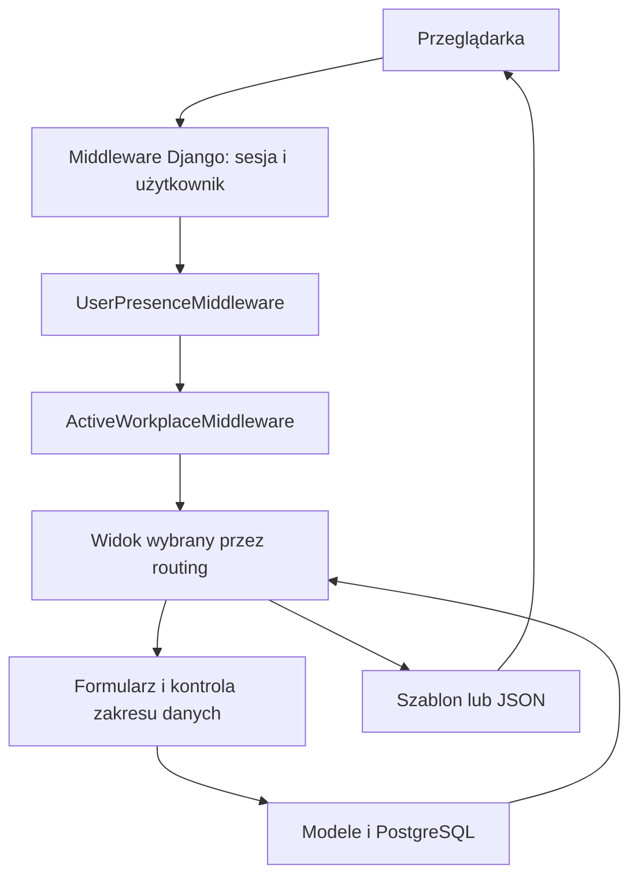
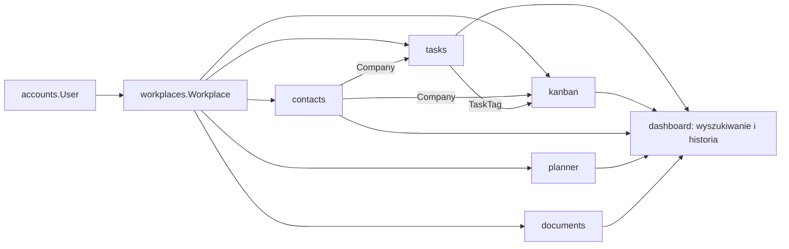

# Architektura Ancore

## 1. Kształt aplikacji

Ancore jest aplikacją Django podzieloną na moduły domenowe we wspólnym procesie.
Serwer pobiera dane przez ORM, waliduje je formularzami i renderuje HTML.
JavaScript dodaje interakcje: dialogi, filtry, kolumny tabel, przeciąganie,
upload, kalendarz i częściową nawigację. Wybrane endpointy zwracają JSON lub
fragmenty HTML.

Główna aplikacja pozostaje szablonowa. Jedyny pakiet frontendowy (`frontend/board`)
buduje odizolowany edytor Excalidraw/React do iframe. Pełne edytory biurowe
uruchamia osobny serwer ONLYOFFICE. Python używa Django, `psycopg2-binary`,
`python-dotenv` i PyJWT. Szczegóły: [Dokumenty](OFFICE.md).
Kod używa mechanizmów PostgreSQL, w tym indeksów GIN i rozszerzenia `pg_trgm`.

Źródła: [settings.py](../ancore/settings.py), [requirements.txt](../requirements.txt),
[główny routing](../ancore/urls.py).

## 2. Struktura katalogów

```text
ancore/                 konfiguracja projektu, główny routing, WSGI/ASGI
accounts/               użytkownik, logowanie, profil, wiele kont, obecność
workplaces/             Workspace, aktywny kontekst, nawigacja, ulubione
tasks/                  projekty, grupy, zadania, tagi, słowniki, terminy
kanban/                 przestrzenie Kanban, tablice, kolumny i karty
contacts/               kontakty, firmy, powiązania z kontami Ancore
planner/                wydarzenia i kalendarz
documents/              Dysk, Dokumenty i bezpieczna integracja edytorów
frontend/board/         izolowany bundle Excalidraw/React i lockfile
deploy/                 lokalny serwer ONLYOFFICE (Compose)
dashboard/              start, ustawienia, globalne szukanie, powiadomienia
core/                   wspólny szablon aplikacji i walidacja uploadu
static/css/             tokeny, reset, układ, komponenty, theme, reguły globalne
static/js/              wspólne i modułowe skrypty przeglądarki
static/img/             logo i favicon
static/vendor/flaticon/ lokalny podzbiór Flaticon UIcons i licencja
media/                  pliki obsługiwane przez standardowy MEDIA_ROOT
private_documents/      prywatne pliki Dysku i Dokumentów
files/                  katalog lokalny; brak aktywnej aplikacji Django o tej nazwie
docs/                   opisy projektu i generowany indeks kodu
scripts/                narzędzia utrzymania dokumentacji
manage.py               wejście do poleceń Django
requirements.txt        zależności Pythona
AGENTS.md               instrukcje pracy agenta
```

`.env` zawiera lokalną konfigurację; `.venv` lokalne środowisko Python.
Treść uploadów i sekrety nie należą do dokumentacji.
Pełny indeks źródeł znajduje się w [CODE_INDEX.md](CODE_INDEX.md).

## 3. Warstwy i odpowiedzialności

| Warstwa | Odpowiedzialność | Główne źródła |
| --- | --- | --- |
| Routing | Wybór modułu, endpointu i nazwy URL | `ancore/urls.py`, modułowe `urls.py` |
| Middleware | Sesja, uwierzytelnienie, obecność, Workspace, CSRF | `ancore/settings.py`, middleware Accounts/Workplaces |
| Widoki | Zakres dostępu, akcja, wybór formularza, odpowiedź | modułowe `views.py`, `tasks/views/`, `kanban/views/` |
| Formularze | Walidacja i wybór dostępnych powiązań | modułowe `forms.py` |
| Modele | Dane, relacje, unikalność, zapis i sygnały | modułowe `models.py`, `migrations/` |
| Szablony | Układ strony, pola, listy i kontrakt `data-*` | modułowe `templates/` |
| CSS | Wygląd i responsywność | `static/css/` |
| JavaScript | Interakcje i komunikacja HTTP | `static/js/` |

Duża część logiki Zadań/Kanbana jest nadal skupiona w dużych plikach widoków
i `static/js/tasks.js`. Nie zakładaj istnienia osobnej warstwy usług dla każdej
operacji. Moduł `workplaces.services` jest rzeczywistą wspólną warstwą kontekstu.

## 4. Przepływ żądania



`AuthenticationMiddleware` działa przed middleware obecności i Workspace.
Widok otrzymuje `request.user` oraz `request.workplace`. Context processory
uzupełniają szablony o avatar, listę Workspace, adresy modułów i ulubione.

GET może mieć uboczne efekty techniczne: obecność, sesja aktywnego Workspace,
uzupełnienie starych rekordów bez Workspace oraz inicjalizacja domyślnych
słowników. Nie utożsamiaj samej metody GET z całkowitym brakiem zapisu w tym kodzie.

## 5. Główne zależności



- `User` jest wspólnym modelem konta. Pola `user`/`owner` w domenach oznaczają
  właściciela rekordu; pola wykonawcy/osoby odpowiedzialnej to osobne relacje.
- `Workplace` jest kontekstem danych; obecny dostęp do Workspace opiera się
  na właścicielu, mimo że istnieje model członkostwa.
- Zadania i Kanban mają różne hierarchie i osobne tabele. Kanban nie jest
  jedynie innym sposobem wyświetlenia `Task`.
- Tagi pochodzą z `tasks.TaskTag` i są używane w Zadaniach i Kanbanie.
- `dashboard` integruje moduły w wyszukiwaniu; powiadomienia buduje z aktywności
  Zadań i Kanbana.
- `core` dostarcza powłokę interfejsu i upload; `core` i `dashboard` nie mają
  własnych modeli domenowych w obecnym kodzie.

## 6. Hierarchie danych

```text
Użytkownik → Workspace
  ├─ Zadania: TaskProject → TaskSection → Task → podzadanie
  │                                      ├─ TaskActivity
  │                                      └─ TaskAttachment
  ├─ Kanban: KanbanProject → KanbanSection → KanbanBoardColumn
  │                                         └─ Kanban → podkarta
  │                                              ├─ KanbanActivity
  │                                              └─ KanbanAttachment
  ├─ Kontakty: Company ← Contact ← UserContact → konto Ancore
  ├─ Kalendarz: CalendarEvent
  ├─ Dysk: DocumentLibrary → Folder / Document (foldery mogą być zagnieżdżone)
  └─ Dokumenty: WorkspaceDocument (płaski katalog)

TaskTag ↔ Task / Kanban
```

Model `WorkspaceDocumentFolder` i relacja `WorkspaceDocument.folder` pozostają
wyłącznie dla zgodności ze starymi danymi; Dokumenty nie udostępniają już folderów.
Podobnie relacje `Document.tags` i `WorkspaceDocument.tags` przechowują jedynie
historyczne powiązania. Dysk i Dokumenty nie udostępniają tagów, nie wyszukują
po nich ani nie przypisują ich przy zapisie lub kopiowaniu.

Diagram pokazuje główną organizację. Niektóre relacje są opcjonalne, np.
zadanie może nie mieć sekcji, a karta kolumny. Reguły `CASCADE`, `SET_NULL`
i `RESTRICT` różnią się między modułami — szczegóły są w modelach i
[opisie mechanizmów](MECHANISMS.md).

## 7. Adresy i punkt wejścia

- `/` pokazuje Dashboard z podsumowaniem aktywnego Workspace.
- `/accounts/...` obsługuje konto; `/workplaces/...` Workspace.
- Moduły mają adresy bazowe `/tasks/`, `/kanban/`, `/contacts/`, `/calendar/`,
  `/documents/` (Dysk), `/office/` (Dokumenty) oraz warianty
  `/workplaces/<slug>/<moduł>/...`.
- Kalendarz ma etykietę aplikacji `planner`, lecz segment URL `calendar`.
- Ustawienia pól projektów są pod `/settings/project-fields/`, ale logika
  znajduje się w `tasks/views/project_settings.py`.
- W `tasks` istnieją zarówno `views.py`, jak i pakiet `views/`. Routing
  używa implementacji w pakiecie. Podobnie nazwa `tasks` w Kanbanie
  jest historycznym nazewnictwem widoków i szablonów kart.

Przy rozbudowie modułu trzeba uwzględnić także nawigację Workspace,
context processor, wyszukiwarkę i ograniczenia częściowej nawigacji.

`DocumentVersion` zachowuje dawne archiwa powiązane z dokładnie jednym rekordem
Dysku albo Dokumentów. Historia wersji nie ma aktywnych ekranów ani endpointów;
nowe zapisy nie tworzą archiwów. `WorkspaceDocument.is_template` oznacza wzorzec w
katalogu właściciela; kopia nie dziedziczy tego oznaczenia.

Dokumenty mają osobne modele w aplikacji `documents`, widoki w
`documents/editor_views.py` i routing `documents/workspace_urls.py` z przestrzeniami
nazw `office` oraz `workplace_office`. Nie są filtrem Dysku i nie przenoszą
jego dotychczasowych danych. Współdzielą prywatny storage, walidację uploadu,
podglądy i powłokę formularzy/modalów. Dysk i Dokumenty korzystają też ze wspólnych
widoków `suite_views.py`, serwisu ONLYOFFICE i powłoki pełnego edytora dla plików
DOCX/XLSX/PPTX/PDF. Zapis pozostaje w modelu źródłowego modułu; osobne podpisy, URL
serwisowe i potwierdzenia zapisu rozdzielają dostęp do obu katalogów.

## 8. Granice tego opisu

Obecność `ASGI_APPLICATION`/pliku ASGI nie oznacza działającej komunikacji
WebSocket. W sprawdzonych źródłach nie ma workera do automatyzacji tagów,
wysyłania przypomnień ani synchronizacji kalendarza z zewnętrznym serwisem.
Aktualne ograniczenia i pozostałości historyczne są zebrane w
[MODULES.md](MODULES.md) i [DEVELOPMENT.md](DEVELOPMENT.md).
