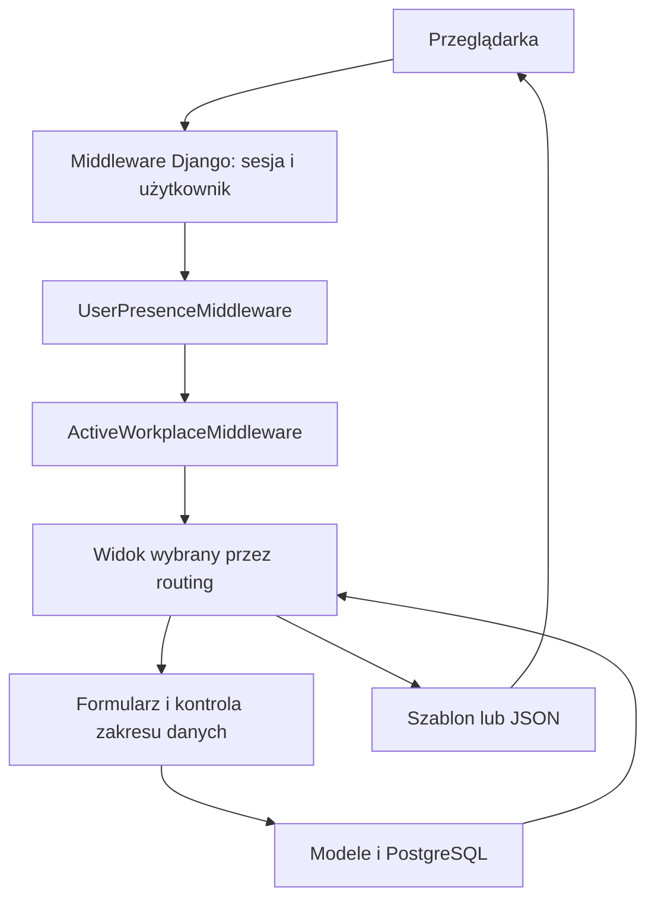
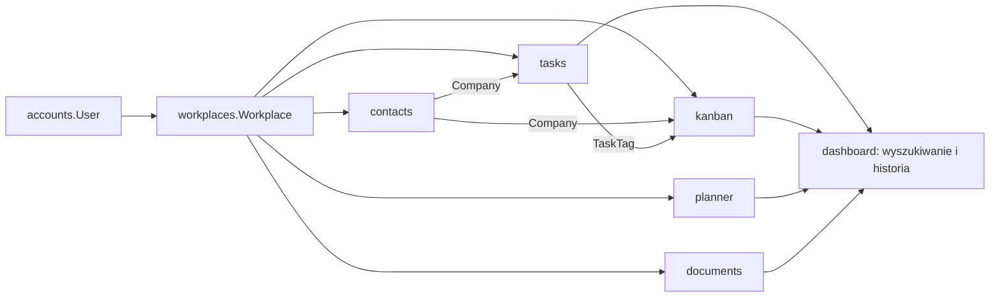

# Architektura Ancore

## 1. Kształt aplikacji

Ancore jest aplikacją Django podzieloną na moduły domenowe we wspólnym procesie.
Serwer pobiera dane przez ORM, waliduje je formularzami i renderuje HTML.
JavaScript dodaje interakcje: dialogi, filtry, kolumny tabel, przeciąganie,
upload, kalendarz i częściową nawigację. Wybrane endpointy zwracają JSON lub
fragmenty HTML.

Główna aplikacja pozostaje szablonowa. Jedyny pakiet frontendowy (`frontend/board`)
buduje odizolowany edytor Excalidraw/React do iframe. Pełne edytory biurowe
uruchamia osobny serwer ONLYOFFICE. Python używa Django, `psycopg2-binary`,
`python-dotenv` i PyJWT. Szczegóły: [Dokumenty](OFFICE.md).
Kod używa mechanizmów PostgreSQL, w tym indeksów GIN i rozszerzenia `pg_trgm`.

Źródła: [settings.py](../ancore/settings.py), [requirements.txt](../requirements.txt),
[główny routing](../ancore/urls.py).

## 2. Struktura katalogów

```text
ancore/                 konfiguracja projektu, główny routing, WSGI/ASGI
accounts/               użytkownik, logowanie, profil, wiele kont, obecność
workplaces/             Workspace, aktywny kontekst, nawigacja, ulubione
spaces/                 przestrzenie, konfiguracje, planowanie i zespoły
tasks/                  kanoniczne zadania, uprawnienia, grupy, historia, pliki
kanban/                 historyczne źródła kart i zgodność starych adresów
contacts/               historyczne kontakty i firmy; bez aktywnego routingu
planner/                wydarzenia i kalendarz
resources/              ewidencja sprzętu, licencji i narzędzi Workspace
documents/              Dysk, Dokumenty i bezpieczna integracja edytorów
frontend/board/         izolowany bundle Excalidraw/React i lockfile
deploy/                 lokalny serwer ONLYOFFICE (Compose)
dashboard/              start, pulpity i gadżety, ustawienia, szukanie, powiadomienia
core/                   wspólny szablon aplikacji i walidacja uploadu
static/css/             tokeny, reset, układ, komponenty, theme, reguły globalne
static/js/              wspólne i modułowe skrypty przeglądarki
static/img/             logo i favicon
static/vendor/flaticon/ lokalny podzbiór Flaticon UIcons i licencja
media/                  pliki obsługiwane przez standardowy MEDIA_ROOT
private_documents/      prywatne pliki Dysku, Dokumentów i komentarzy
files/                  katalog lokalny; brak aktywnej aplikacji Django o tej nazwie
docs/                   opisy projektu i generowany indeks kodu
scripts/                narzędzia utrzymania dokumentacji
manage.py               wejście do poleceń Django
requirements.txt        zależności Pythona
AGENTS.md               instrukcje pracy agenta
```

`.env` zawiera lokalną konfigurację; `.venv` lokalne środowisko Python.
Treść uploadów i sekrety nie należą do dokumentacji.
Pełny indeks źródeł znajduje się w [CODE_INDEX.md](CODE_INDEX.md).

## 3. Warstwy i odpowiedzialności

| Warstwa | Odpowiedzialność | Główne źródła |
| --- | --- | --- |
| Routing | Wybór modułu, endpointu i nazwy URL | `ancore/urls.py`, modułowe `urls.py` |
| Middleware | Sesja, uwierzytelnienie, obecność, Workspace, CSRF | `ancore/settings.py`, middleware Accounts/Workplaces |
| Widoki | Zakres dostępu, akcja, wybór formularza, odpowiedź | modułowe `views.py`, `tasks/views/`, `kanban/views/` |
| Formularze | Walidacja i wybór dostępnych powiązań | modułowe `forms.py` |
| Modele | Dane, relacje, unikalność, zapis i sygnały | modułowe `models.py`, `migrations/` |
| Szablony | Układ strony, pola, listy i kontrakt `data-*` | modułowe `templates/` |
| CSS | Wygląd i responsywność | `static/css/` |
| JavaScript | Interakcje i komunikacja HTTP | `static/js/` |

Duża część logiki Zadań/Kanbana jest nadal skupiona w dużych plikach widoków
i `static/js/tasks.js`. Nie zakładaj istnienia osobnej warstwy usług dla każdej
operacji. Moduł `workplaces.services` jest rzeczywistą wspólną warstwą kontekstu.

## 4. Przepływ żądania



`AuthenticationMiddleware` działa przed middleware obecności i Workspace.
Widok otrzymuje `request.user` oraz `request.workplace`. Context processory
uzupełniają szablony o avatar, listę Workspace, adresy modułów i ulubione.

GET może mieć uboczne efekty techniczne: obecność, sesja aktywnego Workspace,
uzupełnienie starych rekordów bez Workspace oraz inicjalizacja domyślnych
słowników. Nie utożsamiaj samej metody GET z całkowitym brakiem zapisu w tym kodzie.

## 5. Główne zależności



- `User` jest wspólnym modelem konta. Pola `user`/`owner` w domenach oznaczają
  właściciela rekordu; pola wykonawcy/osoby odpowiedzialnej to osobne relacje.
- `Workplace` jest kontekstem danych zespołu. Właściciel i członkowie mają wspólny
  dostęp; role i zakres pierwszej wersji opisuje [Praca zespołowa](TEAMWORK.md).
  Dane zachowują właściciela Workspace, a autor operacji to `request.user`.
  Projekty Zadań mogą być prywatne: `private_owner` i jawny filtr
  `tasks.access.visible_to` ograniczają projekt oraz jego zawartość do tej osoby
  i wskazanych członków projektu z `shared_with` (przez `TaskProjectMembership`).
  `tasks/views/project_team.py` nadaje dostęp natychmiast aktywnym członkom tego
  samego Workspace. Grupy mają analogiczne `TaskSectionMembership` obsługiwane
  przez `tasks/views/section_team.py`; ich dostęp zawęża dostęp projektu.
  Zadania mają `TaskMembership` i `tasks/views/task_team.py`; ich prywatność
  dodatkowo zawęża grupę i całe drzewo rodziców.
  Projekt, grupa i zadanie nie wymagają zaproszeń ani akceptacji; modele zaproszeń
  pozostają wyłącznie historyczne.
  Projekt, grupa, zadanie i Workspace współdzielą szablony tabel zespołu oraz picker osoby.
- Zadania i Kanban mają różne hierarchie i osobne tabele. Kanban nie jest
  jedynie innym sposobem wyświetlenia `Task`. `kanban.access` ogranicza przestrzenie,
  tablice i dziedziczoną zawartość historyczną, obecnie zawsze zwracając pusty
  wynik; wspólne `tasks.access` deleguje do niego modele Kanbana.
  Członkostwa przestrzeni/tablic mają własne tabele i wspólne komponenty UI zespołu.
- Tagi pochodzą z `tasks.TaskTag` i są używane w Zadaniach i Kanbanie.
- `dashboard` integruje moduły w wyszukiwaniu; powiadomienia buduje z aktywności
  typu komentarz z Zadań, zaproszeń oraz osobistych przypomnień `TaskReminder`.
  Wycofany Kanban pozostaje tylko źródłem danych historycznych i mapowań importu.
  Wpisy historii zmian pozostają wyłącznie w historii obiektów.
- `core` dostarcza powłokę interfejsu i upload; `core` nie ma własnych modeli domenowych. `dashboard.NotificationState`
  zapisuje osobisty odczyt, archiwum i usunięcie powiadomień, odwołując się do istniejących
  aktywności, zaproszeń i dostarczonych przypomnień. `ObjectFollow` przechowuje
  osobiste subskrypcje zadań/projektów, a `ActivityInterest` wiąże istniejące
  aktywności z odbiorcami wzmianek i obserwowania, bez kopiowania historii.

## 6. Hierarchie danych

```text
Użytkownik → Workspace
  ├─ Zadania: TaskProject → TaskSection → Task → podzadanie
  │                                      ├─ TaskActivity → TaskCommentImage
  │                                      ├─ TaskAttachment
  │                                      └─ TaskWorkLog
  ├─ Kanban: KanbanProject → KanbanSection → KanbanBoardColumn
  │                                         └─ Kanban → podkarta
  │                                              ├─ KanbanActivity → KanbanCommentImage
  │                                              └─ KanbanAttachment
  ├─ Historyczne dane Kontaktów: Company ← Contact ← UserContact → konto Ancore
  ├─ Kalendarz: CalendarEvent + terminy Task / Kanban (bez kopiowania rekordów)
  ├─ Zasoby: Resource (typ, status, przypisanie, lokalizacja i daty)
  ├─ Dysk: DocumentLibrary → Folder / Document (foldery mogą być zagnieżdżone)
  └─ Dokumenty: WorkspaceDocument (płaski katalog)

TaskTag ↔ Task / Kanban
```

Model `WorkspaceDocumentFolder` i relacja `WorkspaceDocument.folder` pozostają
wyłącznie dla zgodności ze starymi danymi; Dokumenty nie udostępniają już folderów.
Podobnie relacje `Document.tags` i `WorkspaceDocument.tags` przechowują jedynie
historyczne powiązania. Dysk i Dokumenty nie udostępniają tagów, nie wyszukują
po nich ani nie przypisują ich przy zapisie lub kopiowaniu.

Modele `TaskCommentImage` i `KanbanCommentImage` zachowują historyczne nazwy,
ale przechowują zarówno zdjęcia, jak i pozostałe pliki komentarzy.

Diagram pokazuje główną organizację. Niektóre relacje są opcjonalne, np.
zadanie może nie mieć sekcji, a karta kolumny. Reguły `CASCADE`, `SET_NULL`
i `RESTRICT` różnią się między modułami — szczegóły są w modelach i
[opisie mechanizmów](MECHANISMS.md).

## 7. Adresy i punkt wejścia

- `/` pokazuje Dashboard z podsumowaniem aktywnego Workspace.
- `/dashboards/` i `/workplaces/<slug>/dashboards/` udostępniają system
  „Pulpity”. `Dashboard` przechowuje konfigurację i udostępnienie,
  `DashboardGadget` układ oraz filtry; `pulpit_views.py`, `pulpit_forms.py`
  i `pulpits.py` obsługują katalog, zapis i odczyt danych. Właściciel danych
  Workspace (`owner`) jest oddzielony od twórcy (`created_by`).
  `DashboardGroup` przechowuje osobiste grupy użytkownika w Workspace;
  `pulpit_navigation.py` buduje menu gwiazdek, ostatnich i grup z aktualnie
  dostępnych pulpitów. Dotychczasowy Dashboard jest „Pulpitem domyślnym”.
  `/dashboards/manage/` i scoped odpowiednik są osobnym ekranem zarządzania
  własnymi pulpitami, ze wspólną tabelą Przestrzeni i trybem bocznego menu
  `pulpits-management`. Tworzenie/edycja nad tym katalogiem zachowują jego kontekst.
  Katalog `/dashboards/groups/` oraz tworzenie/edycja grup należą do tego samego
  menu zarządzania, jako osobna pozycja „Grupy pulpitów”.
- `/for-you/` oraz `/workplaces/<slug>/for-you/` pokazują osobisty widok
  „Dla ciebie”, składany przez `dashboard/for_you.py` z dostępnych danych.
  `dashboard/recent.py` zapisuje identyfikatory oglądanych elementów w sesji;
  nie tworzy dodatkowych modeli ani kopii danych biznesowych.
- `/accounts/...` obsługuje konto; `/workplaces/...` Workspace.
  Katalog `/workplaces/` jest osobną stroną z własnym menu zarządzania Workspace.
  „Zarządzaj przestrzeniami” ma odrębne menu dotyczące przestrzeni. Okna zarządzania i błędy
  formularzy pozostają nad tym katalogiem, bez zmiany aktywnego Workspace.
- Moduły mają adresy bazowe `/tasks/`, `/kanban/`, `/calendar/`,
  `/documents/` (Dysk), `/office/` (Dokumenty), `/resources/` (Zasoby) oraz warianty
  `/workplaces/<slug>/<moduł>/...`.
- Kalendarz ma etykietę aplikacji `planner`, lecz segment URL `calendar`.
- `/spaces/` jest katalogiem do pracy, a `/spaces/manage/` osobnym ekranem
  zarządzania widocznymi przestrzeniami zgodnie z rolami. Oba mają scoped
  odpowiedniki i korzystają z tych samych modeli. Ekran zarządzania przełącza
  główny pasek boczny na nawigację administracyjną; [szczegóły](SPACES.md).
- System „Wartości pól projektu” jest usunięty. Dawny `/settings/project-fields/`
  zwraca 404; projekty zachowują swoje pola i dotychczasowe wartości.
- `/settings/` jest centrum ustawień konta, Workspace i preferencji.
  Główny pasek boczny pokazuje jego kategorie zamiast menu Workspace,
  także przy częściowej nawigacji; [standard UI](UI.md).
- W `tasks` istnieją zarówno `views.py`, jak i pakiet `views/`. Routing
  używa implementacji w pakiecie. Podobnie nazwa `tasks` w Kanbanie
  jest historycznym nazewnictwem widoków i szablonów kart.

Przy rozbudowie modułu trzeba uwzględnić także nawigację Workspace,
context processor, wyszukiwarkę i ograniczenia częściowej nawigacji.

Zasoby korzystają z osobnego modelu `resources.Resource` i `resources/urls.py`;
scoped namespace to `workplace_resources`. Współdzielą właściciela i aktywny
Workspace, nawigację, ulubione, globalne wyszukiwanie, filtry i paginację Zadań
oraz powłokę modali. Nie są powiązane z prywatnymi projektami ani plikami Dysku.

`DocumentVersion` zachowuje dawne archiwa powiązane z dokładnie jednym rekordem
Dysku albo Dokumentów. Historia wersji nie ma aktywnych ekranów ani endpointów;
nowe zapisy nie tworzą archiwów. `WorkspaceDocument.is_template` oznacza wzorzec w
katalogu właściciela; kopia nie dziedziczy tego oznaczenia.

Dokumenty mają osobne modele w aplikacji `documents`, widoki w
`documents/editor_views.py` i routing `documents/workspace_urls.py` z przestrzeniami
nazw `office` oraz `workplace_office`. Nie są filtrem Dysku i nie przenoszą
jego dotychczasowych danych. Współdzielą prywatny storage, walidację uploadu,
podglądy i powłokę formularzy/modalów. Dysk i Dokumenty korzystają też ze wspólnych
widoków `suite_views.py`, serwisu ONLYOFFICE i powłoki pełnego edytora dla plików
DOCX/XLSX/PPTX/PDF. Zapis pozostaje w modelu źródłowego modułu; osobne podpisy, URL
serwisowe i potwierdzenia zapisu rozdzielają dostęp do obu katalogów.

Katalogi Kontaktów, Firm, Użytkowników i Gości zostały wycofane. `contacts` pozostaje
w `INSTALLED_APPS` dla modeli, migracji i historycznych relacji firm do projektów.
Nie ma rejestracji URL ani ekranów Django admin; dane nie są kasowane.
[Szczegóły](MODULES.md#6-wycofane-katalogi-kontaktów-firm-użytkowników-i-gości).

## 8. Granice tego opisu

Obecność `ASGI_APPLICATION`/pliku ASGI nie oznacza działającej komunikacji
WebSocket. W sprawdzonych źródłach nie ma workera do automatyzacji tagów,
wysyłania push/e-mail ani synchronizacji kalendarza z zewnętrznym serwisem.
Przypomnienia w aplikacji materializuje `dashboard/reminders.py` podczas
odpytywania centrum powiadomień; nie wymagają workera. `TaskProjectTemplate`
przechowuje niezależny snapshot struktury projektu w JSON, odtwarzany przez
`tasks/project_templates.py` w transakcji z normalnym zapisem modeli.
Edytor szablonu otwierany w modalu nad katalogiem zmienia wyłącznie ten snapshot;
endpoint zwraca formularze i wyniki zapisu bez nawigacji strony. Formularze jego grup
i zadań nie zapisują żywych modeli. Każda operacja blokuje wiersz szablonu,
aby równoległe zmiany różnych elementów nie nadpisywały całej struktury.
Aktualne ograniczenia i pozostałości historyczne są zebrane w
[MODULES.md](MODULES.md) i [DEVELOPMENT.md](DEVELOPMENT.md).

## Przestrzenie i zespoły (3.10.2026)

`spaces` jest warstwą organizacji istniejących `TaskProject` i `Task`, nie
osobnym silnikiem zadań. Nowe karty tablicy to te same zadania co na liście.
Po migracji karty Kanbana mają kanoniczne odpowiedniki w Tasks; źródła są
zachowane i wykluczone z bieżących list. `LegacyKanbanMiddleware` obsługuje
historyczne adresy po ustaleniu Workspace. Szczegóły migracji, modeli,
konfiguracji i ograniczeń: [SPACES.md](SPACES.md).
